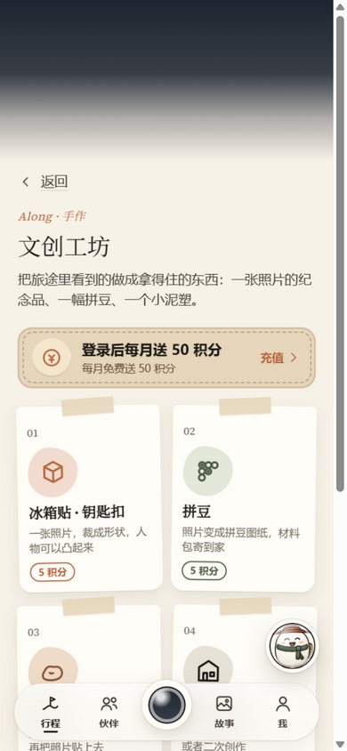
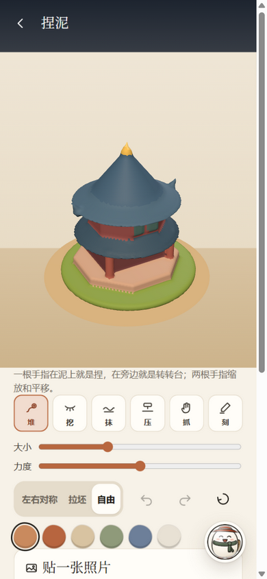
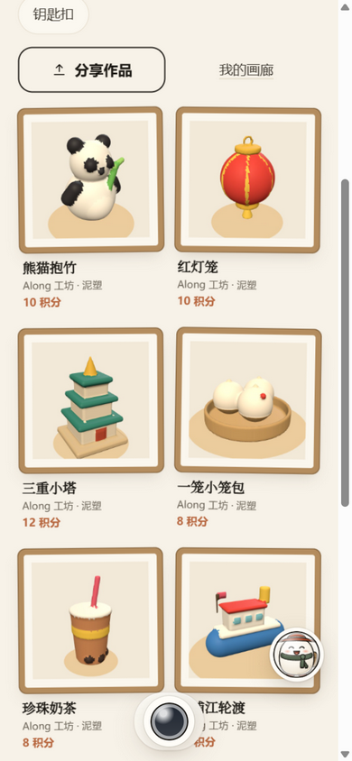
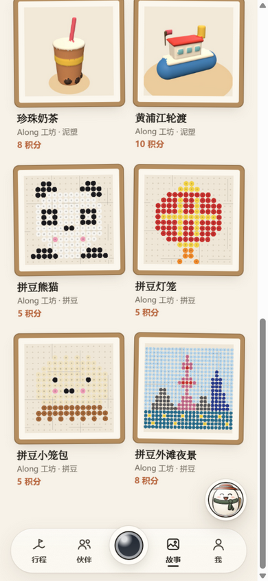

# Along 一起游 · 项目简介

> 面向国内外游客的 AI 旅行陪伴与影像文创平台 · 落地有人接 · 同游有得玩 · 回国带得走

---

## 一、我们要解决的问题

中国的入境游正在快速恢复：240 小时过境免签适用国家增至 **57 国**，可从 **65 个口岸**入境（新华社，2026-08-20）；2026 年三季度外国人入境 **1160.1 万人次**，同比上升 **15.6%**，其中免签入境 **899.2 万人次**，占 **77.5%**（国家移民管理局，2026-10-20）。

政策解决了「能来」，没有解决「来了怎么玩得好」。国内游同样：出行人次远大于入境，但供给高度同质化——同一批网红点位、同一套滤镜、同一份榜单。

两个市场卡住游客的，是同一个结构：**信息过剩而判断稀缺，内容过剩而陪伴稀缺，照片过剩而记忆稀缺。**

| 阶段 | 外国游客 | 国内游客 |
| --- | --- | --- |
| 出发前 | 看不懂中文攻略，不知道哪些点值得去、要多久、周几闭馆 | 攻略同质化，排不出按自己体力、预算、兴趣真正可走的行程 |
| 落地后 | 语言不通、支付不便、无人带路，第一天最慌 | 到现场才发现排队、闭馆、下雨，缺少可即时调整的方案 |
| 旅途中 | 问路、点菜、讲价都要靠翻译软件逐句拼 | 想有人一起走、有人讲、有人拍，独自出行尤其明显 |
| 归来后 | 几十张照片散在相册，讲不出故事，也带不走 | 发完朋友圈就结束，没有可长期留存的实物或作品 |

## 二、产品是什么

**Along = 行程引擎 + 同游网络 + 影像文创**，一个 App 走完一次出行的全周期，并用一条「照片变成东西」的链路把旅程收尾。

四段旅程：**出发前 → 旅途中 → 归来后 → 带走**。当前版本把最后的「带走」扩成了一个完整的文创工坊。

| 模块 | 用户拿到什么 | 当前状态 |
| --- | --- | --- |
| 行程引擎 | 输入到达时间、天数、兴趣、体力、预算，生成分天行程：停留时长、门票、开放时间、交通、雨天备选、费用合计 | 可用 |
| 地图与导航 | 行程与地图共用一条路线；改一站只重排后续；路线失败时退回顺序示意 | 可用 |
| 同游伙伴 | 志愿者（免费陪同）与持证导游（付费讲解）身份分开标注，可筛城市、时段、兴趣 | 可用 |
| AI 助手「小游」 | 问路、翻译、推荐、点菜卡，能把结果一键交给司机看 | 可用 |
| 故事社区 | 发帖先审后发，图片/视频上传转码，示例内容与用户内容分离 | 可用 |
| **文创工坊** | 冰箱贴/钥匙扣浮雕、拼豆图纸与材料包、手工捏泥 3D、文创画廊 | 可用（本版新增） |
| 积分体系 | 每月送 50 积分；¥30 → 600、¥60 → 1200+100；每笔扣费有明细，余额不会扣成负数 | 演示支付，未接真实收款 |

### 界面截图









*四张截图：工坊首页、AI 生成后的捏泥工作台、文创画廊、拼豆图纸。*

### 文创工坊这一段为什么重要

旅行结束时，游客手里只有一堆照片。我们把「照片」变成三种可以带走的东西：

1. **一张照片 → 立体冰箱贴 / 钥匙扣**：人物凸起、有真实厚度，导出 GLB/STL 可打印，也能直接下单制作。
2. **一张照片 → 拼豆图纸**：按 5 mm 豆子自动配色（最多 128 格、32 色），给出编号色卡、每色颗数、熨烫后尺寸与豆板数，材料包可寄到家。
3. **一张照片或一团泥 → 自己捏的 3D 作品**：手机上用手指捏，把旅行照片投影到泥面上；也可以让 AI 先搭一个彩色粗模，再手工改。作品可导出、可分享到文创画廊，别人解锁后可下载或二次创作，作者获得分成。

## 三、技术亮点

### 3.1 单图 3D 人物浮雕：毫米级参数化建模，不是贴图

- 以毫米为单位生成板体轮廓（冰箱贴/钥匙扣 × 圆角/椭圆/拱形/花边），人物区域按 **chamfer 距离场**做倒角凸起，背景保持平面；冰箱贴留 1.2 mm 磁铁槽，钥匙扣留 2.5 mm 挂孔。
- 每件模型逐项校验：索引合法性、退化三角形、**每条边必须被恰好两个三角形反向共享（流形闭合）**、有向体积为正；通过后才导出 GLB（含纹理，米）与 STL（几何，毫米）。
- AI 只给人物轮廓建议，**用户涂抹决定哪块凸起**，界面明确标注「手工选择 / AI 建议」，不冒充完整人体扫描。

### 3.2 手机端捏泥：移植团队的体素距离场引擎

- 泥巴是一张 SDF 体素网格，笔刷直接改格子值，只重新网格化被改到的 16³ 小块；六种笔刷（堆/挖/抹/压/抓/刻）、左右对称与拉坯、逐步撤销。
- 引擎来自团队自研的「捏个 PINCH」，移植后由 `mobile/pinch/along-clay.ts` 补上起手形状、网格转泥、视线拾取、照片投影与撤销栈，打包成一个 35 KB 的前端模块。
- 性能实测：一笔 40 次拖动稳定 60 帧，单次笔触约 3 ms，整块重建 150 ms 以内。

### 3.3 照片 → 彩色 3D 粗模：让模型只输出「结构」

大模型不擅长直接吐顶点。我们让它只输出 3–16 个带颜色的基本体（球、方、柱、锥、胶囊、圆环、棱柱），服务端按 PINCH 规则清洗，手机端转成按部件上色的泥，用户再接着捏。这样 AI 的输出可校验、可编辑、可撤销，而不是一个无法修改的黑盒网格。

### 3.4 AI 行程与受控助手：确定性的写在代码里

- 行程不是「让大模型写一篇攻略」，而是**约束求解内核 + 模型理解偏好**：硬约束（营业时间、到达时刻、交通时长）先过滤，软约束（兴趣、绕路、体力、雨天）加权评分，取可行最优解；每站说明为什么是这里、为什么这个顺序。
- 助手只从已核实的地点库、伙伴库取事实，只能输出白名单动作（打开页面、跳转地点、发起导航、筛选伙伴、复制译文），服务端二次校验，不在白名单一律丢弃。

## 四、技术架构

```text
体验层   Web（手机适配）· Android 壳 + WebView · 管理端
接入层   同源 API · 会话鉴权 · CSRF/Origin 校验 · 邮箱验证码
服务层   行程 · 匹配 · 社区 · 媒体 · 助手 · 建模任务 · 订单 · 审核
AI 层    约束排程 · 人物分割 · 受控对话 · 浮雕参数化 · 部件布局
数据层   PostgreSQL · Redis 队列 · 私有对象存储
交付层   Docker Compose · Nginx · HTTPS · 静态站点 · APK
```

一条贯穿全局的原则：**确定性的写在代码里，不确定的交给模型，模型的结果必须可校验。**

## 五、工程完成度与质量

- **已上线**：https://tokennext.top/along/ （网页端 + 管理端），Android 测试包已生成。
- **自动化测试 531 项**：手机端 437 项 + 服务端 94 项，覆盖权限隔离、行程状态机、几何校验、积分记账幂等、导出与双语文案一致性。
- **安全边界**：数据库/队列/私有存储不暴露公网；媒体与模型按作者鉴权；外部调用只走 HTTPS 443 与精确域名白名单，拒绝重定向、内网与回环地址。
- **积分与订单**：服务端记账，同一幂等键只记一次；AI 任务失败、超时或被拒自动退回积分；余额不会扣成负数。
- **当前边界**：这是可运行的演示版本，支付为演示（不扣真实款项），尚未开展规模化真实用户验证。

## 六、和常见做法的差别

| 常见做法 | Along 的做法 |
| --- | --- |
| 让大模型直接写行程 | 约束求解内核排程，模型只负责理解偏好，结果可解释、可重排 |
| 社区内容先发后审 | 先审后发，审核前仅作者可见，示例内容与真实内容严格分离 |
| 照片加滤镜、生成图片 | 照片变成本地可打印的毫米级模型，能下单做成实物 |
| AI 生成 3D 后无法修改 | AI 只出可编辑的部件布局，用户在工作台上继续捏 |
| 一次性消费 | 积分 + 文创订单 + 画廊分成，把一次旅行延展成可复访的创作 |

## 七、商业化路径

1. **实体文创**：冰箱贴、钥匙扣、拼豆材料包按件收费（当前为演示订单，未接真实支付）。
2. **持证导游撮合**：按订单抽成，志愿者陪同一侧永久免费。
3. **创作者分成**：画廊作品被解锁时，作者获得价格的一半。
4. **B 端**：为城市文旅、景区、博物馆提供点位包与定制文创模板。

## 八、下一步

- 接入真实支付与物流，把演示订单变成可履约订单。
- 扩展到更多城市点位，并把 AI 生成的粗模接入精细网格重建。
- 创作者结算、作品审核规范与版权声明流程。

## 九、团队

| 项目 | 内容 |
| --- | --- |
| 团队名称／学校（单位） | 【待补充】 |
| 成员与分工 | 【待补充】 |
| 指导老师 | 【待补充】 |
| 联系方式 | 【待补充】 |

## 十、链接与素材

- 在线体验：https://tokennext.top/along/
- 管理端：https://tokennext.top/along/admin/
- 代码仓库：https://github.com/NLTuring/along
- 产品截图：`docs/ppt素材/05-产品截图/`（含工坊首页、捏泥工作台、文创画廊、拼豆图纸）
